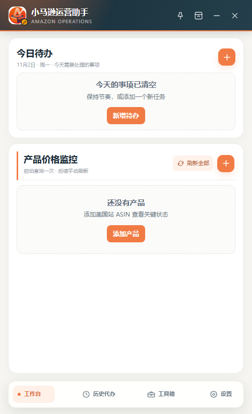

<div align="center">


# 小马逊运营助手

**把分散的运营小工具，装进一个桌面工作台。**

今日待办 · 产品状态 · 发货计划 · 数据填报 · 竞品图片 · 关键词排名


[功能特性](#-功能特性) · [安装使用](#-安装使用) · [本地开发](#-本地开发)

</div>

---

## 💡 为什么做这个？

做亚马逊运营，总会积累一些顺手的小工具：解析箱唛、生成发货计划、填报日表、查关键词排名……工具越来越多，每个都单独打开，切换起来很零散。

小马逊运营助手把这些能力收进同一个 Windows 桌面应用：日常打开工作台处理待办、查看产品状态，需要时从工具箱启动对应功能。深蓝与暖橙配色，紧凑窗口，方便办公时常驻。

> 一个工作台，五个工具入口。主界面统一，工具按需调用；部分任务会启动独立工作进程或浏览器。

## 🖥️ 界面预览



## ✨ 功能特性

### 📅 今日待办与历史记录

- 固定待办支持每日、每周多选日期、每月重复。
- 今日待办集中显示未完成事项，已完成与过期记录归入历史。
- 历史记录支持筛选、恢复和删除。
- 驻留托盘时继续检查提醒，可开启 Windows 通知。

### 📦 产品状态监控

- 添加美国站 ASIN 或商品链接，查询价格、评分及促销、Prime、购物车相关状态。
- 查询前设置美国邮编 10001 和美元，拒绝将非美元价格写入结果。
- 可选择启动时查询一次，后续手动刷新。
- 产品截止日期到期后标红，并生成需要更新日期的系统待办。

### 🧰 五个集成工具

| 工具 | 用途 |
|---|---|
| 工厂发货计划 | 批量解析箱唛 PDF，按仓库与 SKU 合并，生成发货计划 Excel |
| 每日数据填报 | 将产品表现、评分和关键词数据写入已打开的 WPS 日表 |
| 竞品图片采集 | 批量采集商品图和 A+ 图片，生成横向对比 Excel |
| 关键词排名查询 | 配置 ASIN、邮编和关键词，通过浏览器插件查询并下载 Excel |
| 尺寸和重量换算 | 手动换算常用单位，或从整段文本中提取尺寸、重量 |

### 🫧 浮窗与头像悬浮球

- 设置中切换“浮窗 / 悬浮球”，自动保存选择。
- 浮窗支持置顶、吸顶自动隐藏，鼠标移至对应屏幕顶部可展开。
- 悬浮球模式隐藏吸顶按钮；收起或关闭后变为 **40px 圆形头像悬浮球**。
- 支持拖动，点击恢复主界面；更换头像后自动同步，未上传时使用应用图标。
- 支持 Windows 开机自启动；托盘菜单可彻底退出。

## 📥 安装使用

[下载最新 Windows 安装包](https://github.com/CroTuyuzhe/xiaomaxun-ops-assistant/releases/latest)

安装版包含脱敏工作进程和空白发货模板，无需另外安装 Python。首次使用请在产品库中配置自己的 SKU / FNSKU。

1. 下载并运行安装包，按提示选择安装位置。
2. 打开应用，添加待办与需要监控的产品。
3. 点击底部“工具箱”选择工具，在“设置”中调整窗口模式、通知和开机自启动。
4. 更新前先从系统托盘菜单退出旧版。

| 场景 | 需要准备 |
|---|---|
| 待办、单位换算 | 本机即可使用 |
| 产品查询、竞品图片 | 可访问 Amazon 美国站；验证码需手动完成 |
| 关键词排名 | 系统 Chrome、AMZDataStudio 的 Amazon Keyword-Ranking-Tracker 插件及有效登录 |
| 每日填报 | 已安装 WPS，并打开目标工作簿；相关浏览器数据源需已登录 |
| 发货计划 | 箱唛 PDF、产品 SKU / FNSKU 对照及所需模板资料 |

关键词工具使用独立 Chrome 配置，不操作日常浏览器用户目录。公开页面结构、验证码或第三方插件变更可能影响查询结果。

## 🔒 数据存储

待办、产品和设置保存在本机 Electron 用户目录，通常为：

```text
%APPDATA%\小马逊运营助手\data\state.json
```

关闭主窗口后应用可继续驻留；完全退出请使用系统托盘中的“退出软件”。

## 🛠️ 本地开发

需要 Node.js、npm；运行 Python 测试和源码工作进程时还需 Python。

```powershell
npm ci
npm start
```

公开版的产品库均为虚构示例，店铺显示为 StoreA / StoreB / StoreC。公开仓库提供空白发货模板；安装包包含从脱敏源码构建的工作进程，预编译 exe 不提交到源码仓库。

源码使用 Python 业务层，需要安装依赖：

```powershell
python -m pip install -r requirements.txt
```

源码已附空白发货模板。构建完整安装版前，先运行 powershell -ExecutionPolicy Bypass -File scripts/build-workers.ps1 生成 Python 工作进程，再运行 npm run build:win。

```powershell
# 语法检查与业务测试
npm run check

# Windows 安装包
npm run build:win

# Windows 便携包
npm run build:portable
```

构建产物输出到 desktop-dist-v0.5.18/。

## 📂 项目结构

```text
src/
├── assets/          应用图标
├── main/            主进程、窗口控制、本地存储与产品查询
├── preload/         隔离的 IPC 接口
├── renderer/        工作台、工具界面与头像悬浮球
└── tools/           发货计划、数据填报、竞品图片、关键词排名
tests/               业务逻辑与界面契约测试
docs/images/         README 界面截图
```

## 📝 最近更新 · v0.5.18

- 新增浮窗与悬浮球模式切换。
- 悬浮球缩小至 40px，使用用户头像并自动同步。
- 支持点击恢复、拖动移动，兼容现有托盘与置顶功能。

---

<div align="center">

**让每天重复的运营工作，少一点切换。**

Made by [CroTuyuzhe](https://github.com/CroTuyuzhe)

</div>
